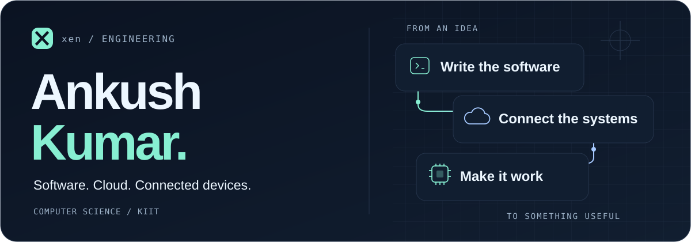
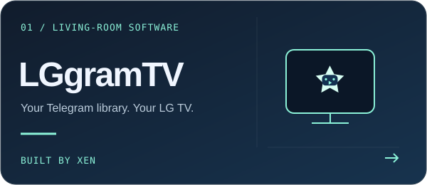
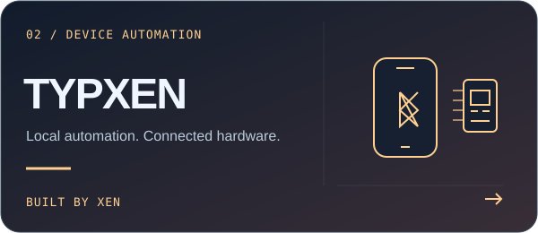

<picture>
  <source media="(prefers-color-scheme: dark)" srcset="assets/hero-dark.svg">
  <source media="(prefers-color-scheme: light)" srcset="assets/hero-light.svg">
  
</picture>

  <a href="https://www.linkedin.com/in/ankush2992"><strong>LinkedIn</strong></a>
  &nbsp; / &nbsp;
  <a href="#selected-builds"><strong>Projects</strong></a>
  &nbsp; / &nbsp;
  <a href="#cloud-credentials"><strong>Credentials</strong></a>
  &nbsp; / &nbsp;
  <a href="https://github.com/ankush29922/LGgramTV/releases"><strong>Try LGgramTV</strong></a>

### Hi, I'm Ankush. I build as **xen**.

I like turning practical problems into software you can actually use: a Telegram
library on a television, an Android app talking to an ESP32, or a Python service
running in the cloud. My interests sit where **software engineering, cloud/DevOps
and connected devices** meet.

**B.Tech, Computer Science & Engineering · KIIT · 2022–2026**

## Selected builds

<table>
<tr>
<td width="50%" valign="top">
  
  
A remote-friendly Telegram media library for LG webOS, powered by a Windows server on your home network.

  
<code>Python</code> <code>JavaScript</code> <code>webOS</code> TV pairing · channel discovery · HTTP ranges · resume playback

  
<a href="https://github.com/ankush29922/LGgramTV/releases"><strong>Download preview ↗</strong></a> &nbsp; <a href="https://github.com/ankush29922/LGgramTV/blob/main/help.md">Setup guide</a>

</td>
<td width="50%" valign="top">
  
  
Android and ESP32-CAM typing automation using local Wi-Fi transfer and Bluetooth keyboard input.

  
<code>Android</code> <code>ESP32-CAM</code> <code>Bluetooth HID</code> Local execution · explicit start/stop controls · firmware releases

  
<a href="https://github.com/ankush29922/TYPXEN/releases"><strong>Explore releases ↗</strong></a> &nbsp; <a href="https://github.com/ankush29922/TYPXEN/blob/main/docs/DEVICE_SETUP.md">Device setup</a>

</td>
</tr>
</table>

These projects have public downloads and documentation. Public availability does not imply that every application component is open source; each repository explains its scope and licensing.

## What I work with

| Area | Tools and technologies |
|---|---|
| **Software** | Python · C · C++ · JavaScript · SQL · HTML/CSS |
| **Cloud & delivery** | Azure ACI / ACR / App Services · Docker · Git · GitHub Actions · CI/CD |
| **Data** | MySQL · MongoDB · SQLite |
| **Devices & interfaces** | Arduino · ESP32 · LoRa · GPS · Telegram APIs · webOS |

## Cloud credentials

**[Oracle Cloud Infrastructure 2025 Certified DevOps Professional ↗](https://catalog-education.oracle.com/ords/certview/sharebadge?id=C004D671BEBCB4B599F391EAACB39EE9C70F9F82013106DD71B70D032D1D7E4B)**  
Oracle · issued August 2025

**[AWS Academy Graduate — Cloud Architecting ↗](https://www.credly.com/badges/efe952e1-72be-4e0d-b48a-105c969c53a2/public_url)**  
AWS Academy training badge · December 2024

<strong>Earlier projects & hackathon work</strong>

### KnowMate · 2024

A Python Telegram bot for spreadsheet-backed student-record lookups, with
interactive commands. Containerized with Docker, deployed using Azure ACI/ACR,
and supported by GitHub Actions lifecycle automation and Azure Monitor.

### Road-Eye · 2024

An IoT road-hazard prototype combining Arduino, GPS and sensors with LoRa
vehicle-to-vehicle communication for areas without network coverage, plus cloud
data synchronization.

### Smart India Hackathon · college round, 2024

Led a **six-person team** building a sensor-based smart irrigation prototype.
Cleared the college selection round among the **top 35 of 300 teams**.

---

**Interfaces that feel good. Systems that behave well.**  
Interested in cloud, practical automation or connected-device projects? [Connect on LinkedIn ↗](https://www.linkedin.com/in/ankush2992)

Built by xen.

